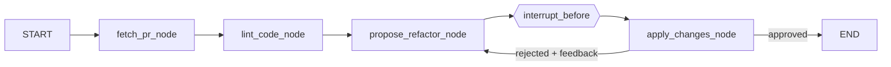

Testing my AI Code Review Agent.
This is my first test pull request.

# Code Review & Refactoring Agent with LangGraph

- **Repository**: [Insert URL]

An autonomous agent that fetches a PR's Python files, lints them in a sandboxed subprocess
(flake8 + black --check), asks an LLM to propose a refactor, **pauses for human approval**,
and only then commits the result back to the branch.

## Architecture



- State persisted with `SqliteSaver` (`checkpoints.db`); every step is a checkpoint.
- Rejection uses `update_state(..., as_node="apply_changes_node")`, which makes the conditional
  edge route back to `propose_refactor_node` with the reviewer feedback in state.

## Installation

1. `python -m venv .venv && source .venv/bin/activate`
2. `cp .env.example .env` and set `GITHUB_TOKEN` (PAT with `repo` scope) and `OPENAI_API_KEY`
3. `pip install -r requirements.txt`
4. Run the API: `uvicorn main:app --reload`
5. Run tests: `pytest -v` (no network or API keys needed; GitHub and the LLM are mocked)

Docker: `docker build -t review-agent . && docker run --env-file .env -p 8000:8000 review-agent`

Interactive docs at http://localhost:8000/docs. A static spec is in `openapi.json`.

## API

| Method | Path | Purpose |
|---|---|---|
| POST | `/api/webhooks/github` | Start a review thread (real PR event, or `{repository_url, branch}` mock) |
| POST | `/api/reviews/{thread_id}/approve` | `{approved, feedback?}` resume, approve, or reject |
| GET | `/api/reviews/{thread_id}` | Inspect draft, lint report, history, next node |

Errors: 404 unknown thread, 409 thread not awaiting approval, 422 invalid payload or reject without feedback.

## Verification walkthrough

```bash
# 1. webhook -> fetch -> lint -> pause (server log: status=awaiting_approval)
curl -X POST localhost:8000/api/webhooks/github -H "Content-Type: application/json" \
  -d '{"repository_url":"https://github.com/YOU/test-repo","branch":"feature/messy"}'

# 2. reject with feedback -> refactor re-runs -> pauses again
curl -X POST localhost:8000/api/reviews/<ID>/approve -H "Content-Type: application/json" \
  -d '{"approved":false,"feedback":"Use list comprehensions instead of loops"}'

# 3. approve -> commit to branch -> thread completes
curl -X POST localhost:8000/api/reviews/<ID>/approve -H "Content-Type: application/json" \
  -d '{"approved":true}'
```

## Known limitations

- Only `.py` files are processed.
- PRs from forks can't be committed to with a standard token.
- The subprocess sandbox uses a temp dir, timeout and a scrubbed environment; for untrusted code, run the service in Docker with no network.

